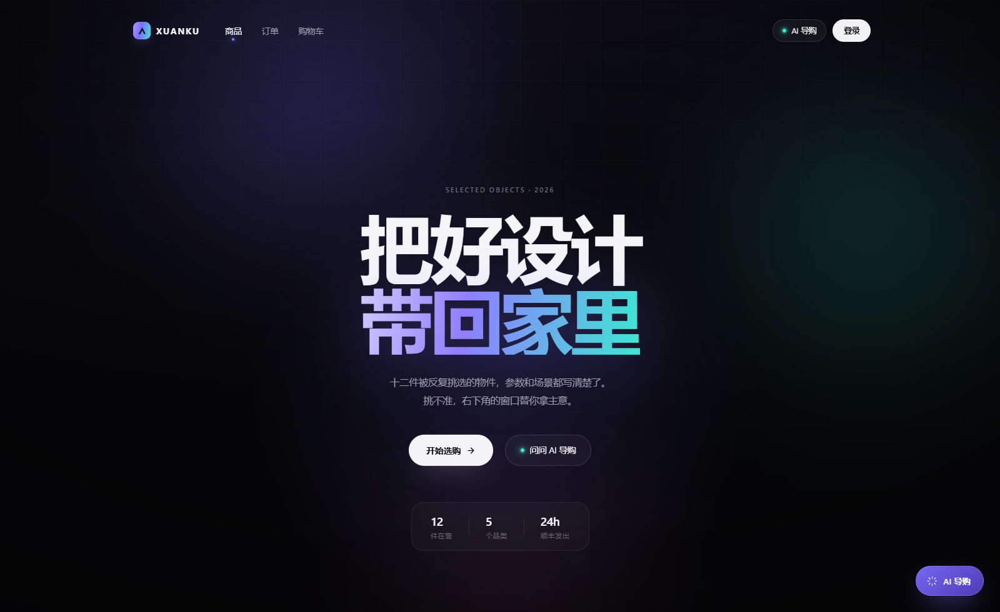
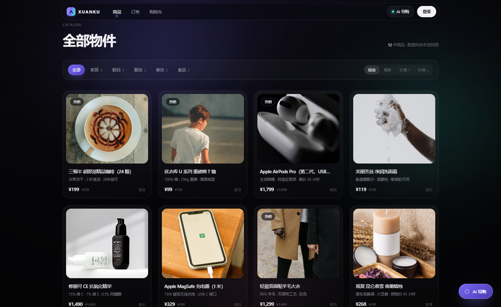
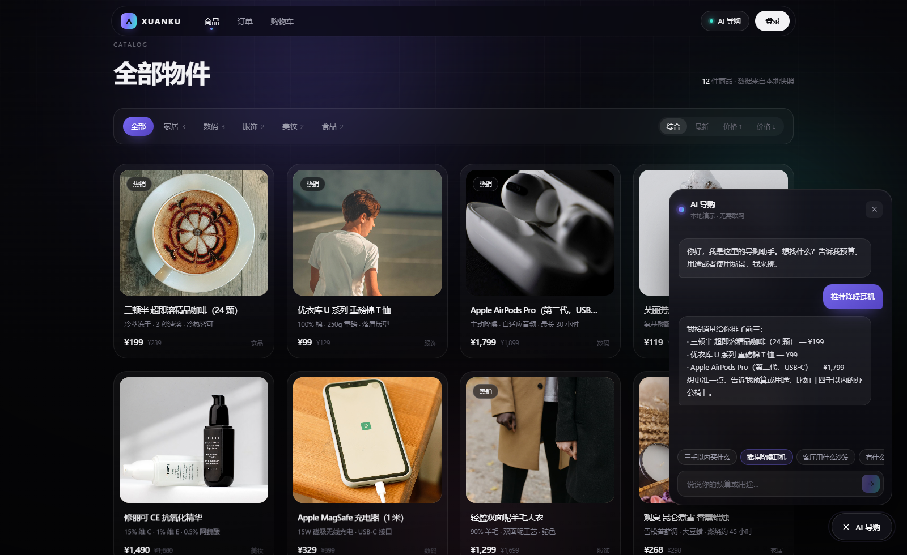
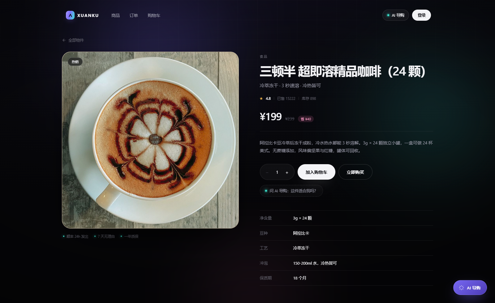
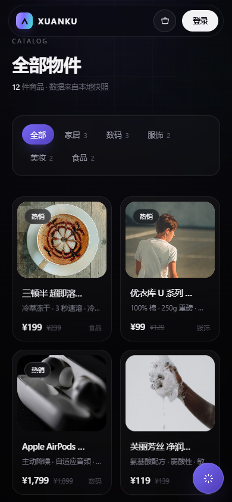

# XUANKU · 把好设计带回家里

一个**纯前端**的高规格电商视觉实验。深空底色、极光渐变、玻璃质感、鼠标光斑与滚动叙事，把「选物」做成一次沉浸式浏览。

不依赖任何后端：商品数据打包在 `public/demo/products.json`，AI 导购是本地规则 + 打字机，离线也能完整走完浏览链路。



## 视觉与交互

| 层 | 做法 |
| --- | --- |
| 底色 | `#07070a` 深空 + 全局噪点（SVG 湍流）+ 三团漂移极光 |
| 导航 | 未滚动时全透明，滚动 24px 后收成 52px 玻璃胶囊 |
| 首屏 | `clamp(46px, 8.6vw, 118px)` 巨型标题，第二行青紫渐变；随滚动 0.18 倍视差并淡出 |
| 商品卡 | 玻璃描边 + 内层 3D 倾斜（±3.4°）+ 跟随鼠标的径向光斑 + 一道斜扫高光 |
| 网格 | IntersectionObserver 按列 70ms 错峰入场，`prefers-reduced-motion` 全量降级 |
| AI 导购 | 右下悬浮按钮 → 玻璃面板，本地意图匹配（预算/品类/新品/性价比）+ 逐字打字机 |






## 技术栈

- Vue 3.5 + Vite 8 + Pinia + Vue Router（History 模式）
- Element Plus **仅按需引入 `ElMessage`**（含样式），主包 198 kB / gzip 76 kB
- 零 UI 框架依赖的视觉层：全部手写 CSS 令牌与关键帧
- 数据兜底：`src/api/demo.js` 仅在接口失败时启用，有后端时永不覆盖真实数据

## 快速开始

```bash
npm install
npm run dev       # http://localhost:5173
npm run build     # 产物在 dist/
npm run preview
```

## 部署

**Cloudflare Pages**

```bash
npx wrangler pages deploy dist --project-name=<project> --branch=main
```

**GitHub Pages**：把 `dist/` 推到 `gh-pages` 分支，注意 SPA 回退（`public/_redirects` 仅 Cloudflare 生效，GitHub Pages 需要用 404.html 方案）。

产物已内置：

- `_redirects`：`/* → /index.html 200`，深链不 404
- `_headers`：资源长缓存、`index.html` 不缓存、基础安全头

## 目录

```
src/
├── api/            # axios 封装、SSE、静态兜底快照
├── components/     # ShopLayout（壳）、AiDock（本地 AI 导购）
├── directives/     # v-reveal 入场指令
├── router/
├── stores/         # 用户 / 购物车
├── views/shop/     # 首页、详情、购物车、订单、登录、个人中心
└── style.css       # 设计令牌 + Element Plus 深色映射
```

## 边界

这是展示站，不是交易系统：登录、下单、订单都依赖后端接口，静态环境下会提示失败，属预期行为。购物车存在 localStorage，加购本身可用。
